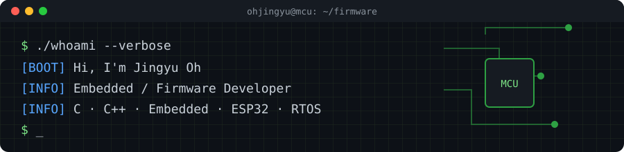

<p align="center">
  
</p>

<p align="center">
  <a href="https://www.notion.so/seolhwa0819/f3a1070ecd734df282f11e44b77a369b"></a>
  <a href="https://www.instagram.com/seolhwa_jg/"></a>
</p>

### `> about`

```c
struct developer ohjingyu = {
    .role     = "Embedded / Firmware Developer",
    .focus    = { "MCU bring-up", "Peripheral drivers", "RTOS" },
    .interest = "Low-level, close to the metal",
};
```

### `> tech_stack`

<p>
  
  
  
  
  
</p>
<p>
  
  
  
  
</p>

### `> projects`

| Project | Description | Stack |
|---|---|---|
| **미니입실기** | 소형 출입 인증 단말기 펌웨어 | `C` `MCU` |
| **자사입실기** | 자사 출입 인증 단말기 펌웨어 | `C` `MCU` |
| **QR_PASS** | QR 코드 기반 출입 인증 시스템 | `C` `QR` |
| [**locker_control**](https://github.com/ohjingyu/locker_control) | 사물함 제어 | `C` |
| [**tobe_device_finder**](https://github.com/ohjingyu/tobe_device_finder) | 장치 검색 도구 | — |

### `> stats`

<p align="center">
  
  
</p>
<p align="center">
  
</p>
<p align="center">
  
</p>

<p align="center">
  
</p>
